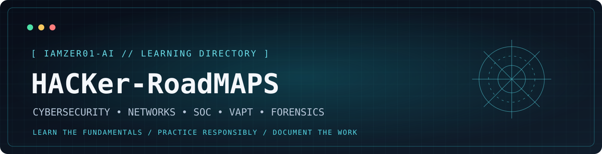

# HACKer-RoadMAPS

**A practical cybersecurity learning map — from fundamentals to defensive security, ethical VAPT, and digital forensics.**

[GitHub Profile](https://github.com/IamZer01-ai) · [Cybersecurity Learning Lab](https://learning-no.github.io/Cybersecurity-Learning-Lab/) · [Cyber Sentinel](https://github.com/IamZer01-ai/IamZer01-Sentinel)

---

## About this repository

HACKer-RoadMAPS is a structured learning and reference space for cybersecurity. It organizes topics into clear stages, explains what to learn, and points toward safe, authorized practice.

The goal is to build strong fundamentals first, understand how security work is performed, and document learning through practical projects.

## Learning roadmaps

| Track | What you will learn |
|---|---|
| **01 · Cybersecurity Foundations** | Security principles, common threats, risk, authentication, access control, and security awareness. |
| **02 · Networking & Linux** | TCP/IP, DNS, HTTP/HTTPS, ports, routing, Linux commands, permissions, and system basics. |
| **03 · SOC & Blue Team** | Logs, alert triage, incident response, indicators of compromise, SIEM concepts, and security monitoring. |
| **04 · Ethical VAPT** | Scope and authorization, reconnaissance concepts, web security, OWASP Top 10, vulnerability validation, and responsible reporting. |
| **05 · Digital Forensics** | Evidence handling, forensic imaging concepts, file systems, timelines, mobile forensics concepts, and clear documentation. |
| **06 · Secure Development** | Secure coding basics, input validation, authentication, access control, SQL safety, and security testing. |
| **07 · Career & Projects** | Portfolio building, report writing, interview preparation, and documenting practical work. |

## Suggested learning order

1. Learn computer and networking fundamentals.
2. Become comfortable with Linux and basic scripting.
3. Study core security concepts and common attack patterns.
4. Choose a direction: SOC/Blue Team, VAPT, or Digital Forensics.
5. Practice only in systems you own or have explicit permission to test.
6. Record findings, explain the impact, and write clear reports.
7. Build small projects and publish accurate documentation.

## Tools to become familiar with

| Area | Examples |
|---|---|
| Network analysis | Wireshark, Nmap |
| Web security testing | Burp Suite, OWASP ZAP |
| Vulnerability assessment | Nessus |
| Digital forensics | Autopsy, FTK, MOBILedit |
| Operating systems & scripting | Linux, Python, SQL |

Tools are for learning and authorized assessment. A tool result is not automatically proof of a vulnerability; verify findings safely and document limitations.

## Projects and learning resources

- **[Cybersecurity Learning Lab](https://learning-no.github.io/Cybersecurity-Learning-Lab/)** — structured learning material and roadmaps.
- **[Cyber Sentinel](https://github.com/IamZer01-ai/IamZer01-Sentinel)** — a cybersecurity/SOC platform project.
- **[GitHub profile](https://github.com/IamZer01-ai)** — additional projects and learning notes.

## How to use the roadmaps

Each topic should answer four questions:

- **What is it?** A simple explanation of the concept.
- **Why does it matter?** Where it is used in real security work.
- **What should I know first?** The required foundations.
- **How can I practice safely?** A lab, exercise, or project with clear authorization.

## Responsible learning

This repository is for education and defensive security. Test only in your own lab, intentionally vulnerable training environments, or systems where you have clear permission. Do not access, disrupt, or collect data from systems without authorization. Follow applicable laws and responsible disclosure practices.

## Attribution and license

This repository is an adaptation inspired by the structure and presentation of [SagarBiswas-MultiHAT/SagarBiswas-MultiHAT](https://github.com/SagarBiswas-MultiHAT/SagarBiswas-MultiHAT). The original project is distributed under the MIT License. Its original copyright and license notice are retained in [LICENSE](LICENSE). Personal profile details, photographs, certificates, and unrelated third-party project claims from the source have not been carried over.

---

Maintained by [IamZer01-ai](https://github.com/IamZer01-ai)

**Learn the fundamentals. Practice responsibly. Document what you learn.**

